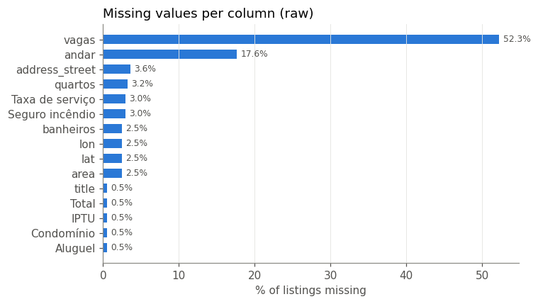
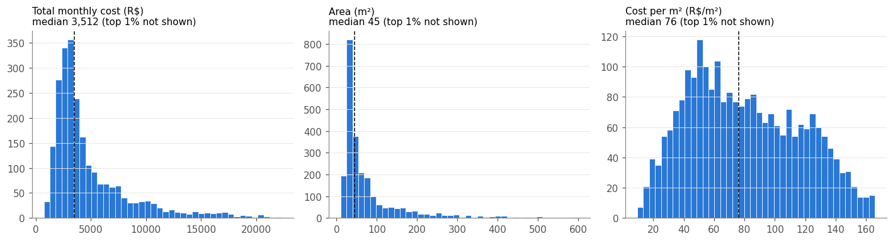
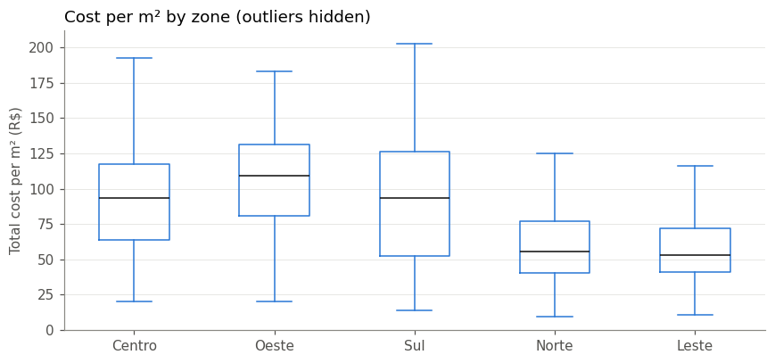

# Where should AI live? — Part 1: Collecting 2,500 rental listings in São Paulo (without being a bad citizen)

*This is the first article in a series about building a home finder that starts from a simple question: **"How long are you willing to commute?"** Each article covers one stage: data collection, database, mobility data, machine learning, the app, and an LLM chatbot.*

---

## Why start with the data?

Most rental websites let you filter by price, number of bedrooms or neighbourhood. None of them answer the question people actually care about in a city like São Paulo: *"If I work at Avenida Paulista and I'm willing to spend 40 minutes on the metro, where can I live?"*

Answering that needs three ingredients:

1. **Listings with exact locations.** This article covers them.
2. **Travel times between any two points in the city.** That is a later article on mobility data.
3. **A way to rank what's left.** Later articles cover clustering and recommendation.

Everything downstream depends on the first ingredient, so it deserves care. This article covers how I collected **2,489 listings across 25 neighbourhoods**, what went wrong along the way, and how the dataset was cleaned and tested.

> **Note on the data:** this is an educational, non-commercial project. The scraped data is kept private and isn't published; only code and aggregated results are shared. More on that in the [ethics section](#ethics-what-i-did-and-didnt-do).

---

## Scope: 25 neighbourhoods, 5 per zone

São Paulo is huge: 96 districts and more than 11 million people. To keep the project manageable, I picked **5 neighbourhoods in each of the city's 5 zones** (Centro, Oeste, Sul, Norte, Leste) and capped collection at **100 listings per neighbourhood**. That is enough for analysis, small enough to collect in under an hour, and it covers the city's very different housing markets, from Pinheiros to Itaquera.

| Zone | Neighbourhoods |
|---|---|
| Centro | República, Bela Vista, Consolação, Liberdade, Santa Cecília |
| Oeste | Butantã, Perdizes, Pinheiros, Vila Leopoldina, Vila Madalena |
| Sul | Brooklin, Interlagos, Moema, Santo Amaro, Vila Mariana |
| Norte | Casa Verde, Mandaqui, Santana, Tucuruvi, Vila Maria |
| Leste | Itaquera, Mooca, Penha, São Miguel Paulista, Tatuapé |

---

## Architecture: two stages, two tools

The scraper has two stages, because the two pages involved behave differently.

```
 Search page (per neighbourhood)            Listing pages (one per property)
 ┌───────────────────────────────┐          ┌──────────────────────────────────┐
 │ JavaScript-rendered,          │  URLs    │ Server-rendered HTML with         │
 │ "Load more" button            │ ───────► │ structured data (JSON-LD, Next.js)│
 │ → Selenium (headless Chrome)  │          │ → httpx (async, HTTP/2)           │
 └───────────────────────────────┘          └──────────────────────────────────┘
                                                          │
                                                          ▼
                                     parser → one CSV per neighbourhood → merge → clean
```

**Stage 1: collect URLs with Selenium.** The neighbourhood search page loads 12 listings at a time, and more appear only when you click "Load more". This needs a real browser, so Selenium drives headless Chrome, clicks until it has 100 listing links, and saves them to a text file. If the run is interrupted, the file is reused.

**Stage 2: fetch listings with async HTTP.** Individual listing pages don't need a browser; the HTML already contains everything. Opening 2,500 pages in Chrome would be slow and wasteful, so this stage uses `httpx` with `asyncio`:

```python
semaphore = asyncio.Semaphore(CONCURRENCY)   # at most 3 requests in flight

async def process_with_semaphore(url):
    async with semaphore:
        result = await self.process_single_url(client, url)
        await asyncio.sleep(REQUEST_DELAY)    # 1 s pause after every request
        return result
```

Retries use **exponential backoff**. A `429 Too Many Requests` doubles the wait each attempt (2 s, 4 s, 8 s), a `5xx` server error retries with a growing delay, and other `4xx` errors aren't retried at all. In the final run, 12 of 2,489 pages couldn't be fetched. About half were still answering `503` after three attempts, and the rest returned `404` because the listing had been taken down between collecting the URL and fetching the page. Listings rent fast!

**Throughput:** about 2 minutes per neighbourhood, and **46 minutes** for all 25.

---

## Parsing: three places to look for the same fact

A listing page contains the same information in several forms. The parser tries the most reliable source first:

1. **JSON-LD** (`<script type="application/ld+json">`): structured data meant for search engines. It is stable and machine-readable, and it carries the address and price.
2. **The visible DOM**, through CSS selectors such as `data-testid="house-main-info"`. This is where area, bedrooms, bathrooms, parking, floor, pets and furniture appear as short texts like *"2 quartos (1 suíte)"* or *"Aceita pet"*.
3. **Next.js page data** (`<script id="__NEXT_DATA__">`), a large JSON blob that the front-end framework uses to hydrate the page. This is where the **coordinates** were.

### Finding coordinates without knowing where they are

I didn't want to hard-code a path like `props.pageProps.house.address.lat`, which would break the next time the site's front-end changes. So the parser searches the JSON **recursively** for any object with latitude/longitude-like keys, and **validates** the values against a bounding box around São Paulo:

```python
def _find_coords(obj, depth=0):
    if isinstance(obj, dict):
        lat = _to_float(obj.get("latitude", obj.get("lat")))
        lon = _to_float(obj.get("longitude", obj.get("lng", obj.get("lon"))))
        if _valid_sp_coords(lat, lon):          # -24.1 < lat < -23.3, -47.0 < lon < -46.3
            return lat, lon
        for value in obj.values():
            if found := _find_coords(value, depth + 1):
                return found
    elif isinstance(obj, list):
        ...
```

The bounding box matters. Without it, a `{"lat": 0, "lng": 0}` placeholder elsewhere in the page would be accepted as a valid location in the Atlantic Ocean.

**Result: 97.5% of listings came with exact coordinates.** I had planned a whole day for geocoding street addresses with OpenStreetMap's Nominatim, and it turned out to be unnecessary. That was lucky, because **65% of listings hide their street address** and only show the placeholder *"Condomínios em São Paulo"*. Geocoding would have failed for most of them.

---

## The bug that a single number revealed

After the first full run, a quick look at the value distributions showed this:

```
pet            {'sim': 0.731, 'não': 0.269}
metro_proximo  {'sim': 0.992, 'não': 0.008}
```

**99.2% of listings "near a metro station"**, in a sample that includes Itaquera, Interlagos and São Miguel Paulista? That is not plausible.

The cause was a classic substring bug:

```python
elif "aceita pet" in text_lower:      # "Não aceita pet" contains "aceita pet"!
    self.pet = "sim"
elif "metrô" in text_lower:           # "Sem metrô próx." contains "metrô"!
    self.metro_proximo = "sim"
```

Negative wording matched the positive keyword. The fix checks for negations first and is covered by tests that use the exact phrasings:

```python
@pytest.mark.parametrize("text, field, expected", [
    ("Aceita pet",       "pet",           "sim"),
    ("Não aceita pet",   "pet",           "não"),
    ("Metrô próx.",      "metro_proximo", "sim"),
    ("Sem metrô próx.",  "metro_proximo", "não"),
])
```

After the fix and a re-scrape, the metro share dropped from **99.2% to 64.9%**, a believable number. The pet share barely moved (73.1% → 71.8%), so *"Não aceita pet"* turned out to be rare, but the code is now right for both.

**Lesson:** the parser reported a 100% success rate the whole time, because "success" only meant *no exception was raised*. Wrong values don't raise exceptions, and a `value_counts()` on every categorical column is the cheapest data test there is.

---

## Cleaning: the funnel

Raw scraped data is never analysis-ready. The cleaning step (`scraper/clean.py`) is a sequence of filters, and it logs how many rows each one removes:

| Step | Rows left | Removed |
|---|---:|---:|
| Raw listings | 2,489 | — |
| Parsed successfully | 2,477 | 12 |
| In the city of São Paulo | 2,473 | 4 |
| Has coordinates | 2,424 | 49 |
| Area between 10 and 1,000 m² | 2,419 | 5 |
| Cost per m² between R$ 5 and R$ 400 | 2,418 | 1 |
| Within 4 km of its neighbourhood's centre | 2,416 | 2 |

Some cases worth highlighting:

- **The title as a backup source.** The parking field was empty for about half the listings, because the page shows `-` when there's no parking spot. The title is generated by the site in a fixed format, *"Studio para alugar com 31m², 1 quarto e sem vaga"*, so a regex on the title fills parking, bedrooms and area when the main block is empty.
- **A neighbouring city in the results.** The *Vila Maria* search returned a few listings from **Vila Maria in Guarulhos**, a different city. The listing URL ends with the city name (`…-vila-maria-guarulhos`), which makes them easy to filter out.
- **A URL format I didn't know about.** My first city filter (`url.endswith("-sao-paulo")`) wrongly removed 14 listings from São Miguel Paulista. They turned out to be partner-agency ads ("classificados") with a short URL, `/classificado/<id>/alugar`, which has no city in it at all. They are legitimate listings, just without QuintoAndar's service fee and insurance. I fixed the filter to drop only URLs that *name another city*.
- **Points far from home.** A listing more than 4 km from the median location of its neighbourhood's listings is probably mislabelled, and is dropped.
- **Plausibility ranges.** Area must be between 10 and 1,000 m², total monthly cost between R$ 300 and R$ 50,000, and cost per m² between R$ 5 and R$ 400.

**Final dataset: 2,416 listings (97.1% of raw), 26 columns, all with coordinates**, and an almost even split across zones (474–488 each).


*Missing values in the raw data. Parking looks half-empty, but it's really "no parking", which the title confirms.*

---

## A first look at the data


*Typical listing: R$ ~3,500 per month in total, 45 m², ~R$ 76 per m². All three have long right tails (big houses and luxury flats).*



| Zone | Median total cost per m² (R$/month) |
|---|---:|
| Oeste | 109 |
| Centro | 94 |
| Sul | 94 |
| Norte | 55 |
| Leste | 53 |

The west and centre of the city cost about twice as much per square metre as the north and east. Commute time is a big part of that, which is exactly what the next articles will quantify.

---

## Testing a scraper

Scrapers are notoriously hard to test, because the thing they depend on (someone else's website) changes without notice. I used two kinds of test:

- **Synthetic unit tests**, which always run. They cover hand-written snippets such as `"2 quartos (1 suíte)"`, `"Sem vaga"`, a minimal HTML page with JSON-LD, URL cleaning, coordinate validation, price parsing (`"R$ 1.400"` → 1400, `"Incluso"` → 0) and an end-to-end run of the cleaning function on five fake rows.
- **Fixture tests**, which use three real listing pages saved to disk: one with a visible street, one with a hidden address, and one without parking. They check that price, area, rooms, address and coordinates are all extracted. Because they contain real data, the fixtures are git-ignored, and the tests **skip themselves** when the files are missing, so the public repo's test suite still passes.

Current status: **32 tests passing.**

---

## Ethics: what I did and didn't do

Scraping sits in a grey zone, and it's worth being explicit about the choices made here.

**What I did:**
- **Respected `robots.txt`.** The site allows the neighbourhood search pages and the listing pages, and disallows URLs with tracking parameters such as `?search_id=`. The search page's links include exactly those parameters, so the collector **strips query strings** before fetching any listing.
- **Kept the load low.** Three concurrent requests, a 1-second pause after each, backoff on errors, 100 listings per neighbourhood, and a one-off collection with no continuous crawling.
- **Collected no personal data.** No names, phone numbers, photos or free-text descriptions, only listing facts: price, area, rooms and location. That keeps the project clear of LGPD (Brazil's data-protection law) concerns.
- **Didn't disguise the bot.** The original version of this scraper had code to hide that the browser was automated (masking `navigator.webdriver`). I removed it, because it doesn't belong in a project that claims to be polite.

**What I didn't do:**
- **Publish the data.** The repository contains only code. The data, the saved pages and the exploratory notebooks with real values stay on my machine, and articles show aggregated results only.
- **Use it commercially.** This is a learning project.

I also want to be transparent that, like many websites, QuintoAndar's Terms of Use do not permit automated data collection. For a portfolio project, I chose to collect a small, one-off sample under the constraints above and to keep it private. If you build on this code, read the terms of the site you target, and prefer an official API or an openly licensed dataset when one exists.

---

## Try it yourself

Alongside this article there's a **single-file version** of the scraper, [`scrape_listings.py`](scrape_listings.py), about 200 lines and with no project structure. It runs the whole machinery for one neighbourhood: Selenium for URLs, async httpx for the pages, the parser with coordinates, and a CSV at the end.

```bash
pip install selenium "httpx[http2]" beautifulsoup4 lxml pandas
python scrape_listings.py --bairro liberdade --n 15
```

```
[1/3] Collecting 15 listing URLs from https://www.quintoandar.com.br/alugar/imovel/liberdade-sao-paulo-sp-brasil
      24 URLs so far
[2/3] Fetching 15 listings (3 at a time, 1.0s pause)
[3/3] Saved 15 listings to listings_liberdade.csv in 29s
      with coordinates: 100%
   bedrooms  area_m2  parking  Aluguel  Total        lat        lon
0         3      120        1     4500   6274 -23.569532 -46.639065
1         1       29        0     2300   2873 -23.554612 -46.634240
...
```

Change `--bairro` to any neighbourhood slug from the site's URLs, such as `pinheiros` or `vila-mariana`, and `--n` to the number of listings you want. Keep it small, and keep the delays.

---

## What's next

The dataset is clean, but it's still a pile of CSV files. In the next article I'll load it into **PostgreSQL with PostGIS**, index each listing on an **H3 hexagonal grid**, and write the spatial queries that the rest of the project depends on, such as *"listings within 500 m of a metro station"*.

*Code: [github.com/devienne/where_should_ai_live](https://github.com/devienne/where_should_ai_live)*
