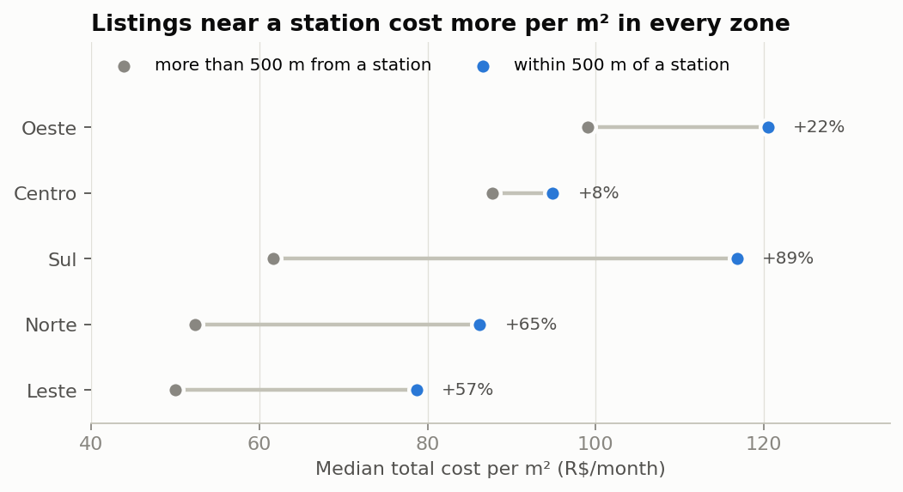
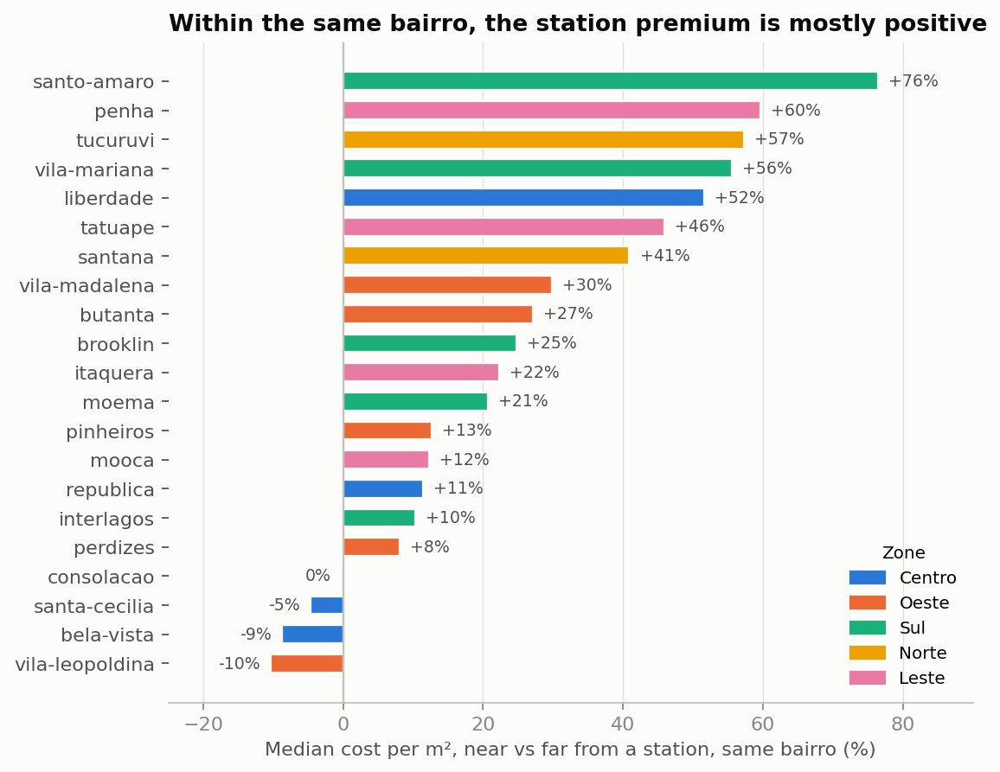
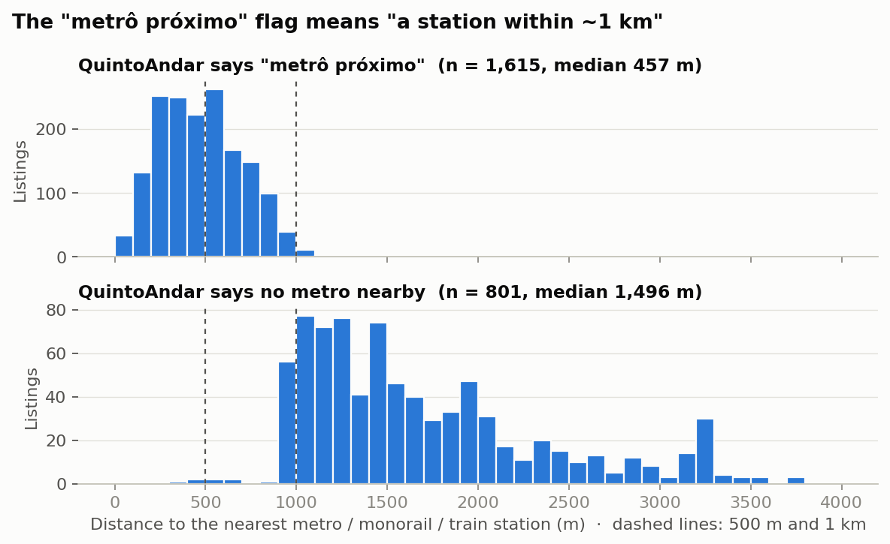
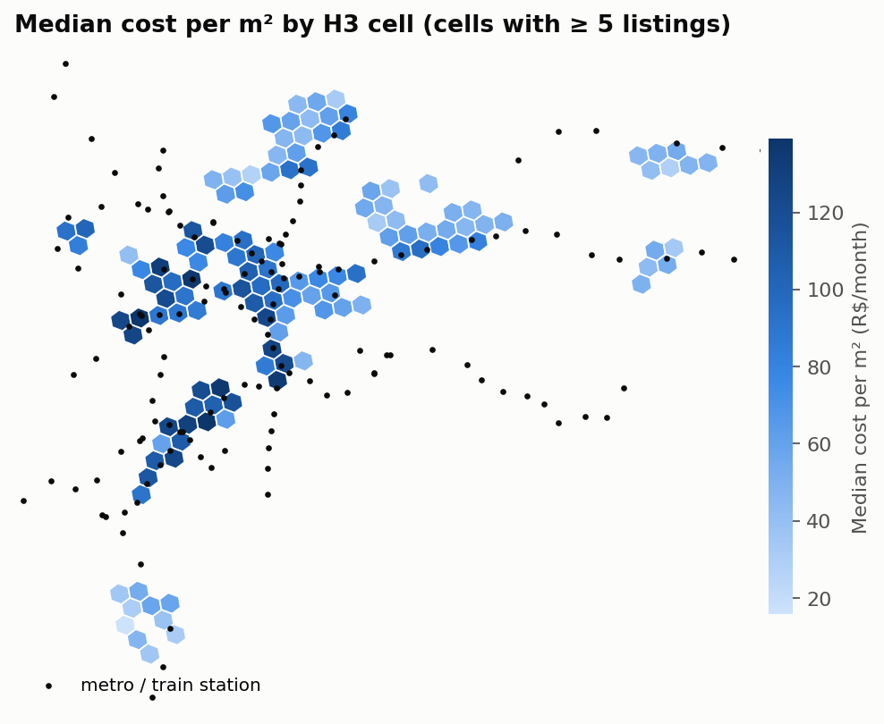

# Where should AI live? — Part 2: From CSV files to a spatial database (PostgreSQL, PostGIS and H3)

*This is the second article in a series about building a São Paulo home finder that starts from one question: **"How long are you willing to commute?"** [Part 1](../01_scraping/article.md) collected 2,416 clean rental listings. This part puts them in a database that can answer questions about **space**.*

---

## Why a database at all?

After Part 1, the data was a tidy CSV. For the next steps, a CSV stops being enough:

- **Spatial questions.** *"Which listings are within 500 m of a metro station?"* In pandas, that means computing every listing–station distance by hand.
- **Fast lookups.** The app will ask *"which homes are within 40 minutes of this workplace?"* over many thousands of travel-time pairs, again and again.
- **One source of truth.** The API, the app and the chatbot all need the same data. Three scripts reading three copies of a CSV is how bugs are born.

The tool for this is **PostgreSQL** with **PostGIS**, the extension that teaches Postgres about points, distances in metres and spatial indexes. Both are free and widely used.

---

## Running it: Docker, not a local install

I already had PostgreSQL installed on my machine, and it would have worked. I still ran the project's database in **Docker**:

```yaml
services:
  db:
    image: postgis/postgis:16-3.4          # PostgreSQL 16 + PostGIS 3.4, pinned
    environment:
      POSTGRES_USER: ${POSTGRES_USER}      # credentials come from .env, never from the repo
      POSTGRES_PASSWORD: ${POSTGRES_PASSWORD}
      POSTGRES_DB: ${POSTGRES_DB}
    ports:
      - "${POSTGRES_PORT:-5432}:5432"
    volumes:
      - pgdata:/var/lib/postgresql/data    # data survives container restarts
    healthcheck:
      test: ["CMD-SHELL", "pg_isready -U ${POSTGRES_USER} -d ${POSTGRES_DB}"]
```

Why Docker:
- **Reproducible.** Anyone who clones the repository gets the same database, with PostGIS already installed, from one command (`docker compose up -d`). There's no "install Postgres 16, then add PostGIS through StackBuilder…" section in the README.
- **Isolated.** The container runs on port 5433 next to my local PostgreSQL on 5432, and neither knows about the other. If I break the schema, `docker compose down -v` gives me a clean slate in seconds.
- **One file for the whole stack.** Later parts add a routing engine, an API and a web app to the same `docker-compose.yml`.

The password lives in a git-ignored `.env` file. The repository has a `.env.example` template instead, so anyone cloning it knows which settings to fill in without seeing mine.

---

## Schema design: hexagons as the backbone

The schema has five tables. Two are filled in this article, and the rest are filled in later parts. Designing them all now forced one decision early: **how do the parts of the project connect?**

```
listings ──h3_r8──► areas ◄──home_h3── travel_times ──work_h3──► (the user's workplace cell)
    │                                                                  ▲
    └── ST_DWithin ──► stations                     geocode_cache ─────┘  (address → cell)
```

### Why H3 hexagons?

Commute times are the heart of this project. Computing a route from every listing to every possible workplace is impossible. So the city is divided into **H3 cells**, Uber's open hexagonal grid. At resolution 8, each cell is about 0.7 km², roughly a few blocks. Travel times are then computed **from cell to cell**: *"if you work in cell X, here are the minutes to every cell with homes"*.

An H3 cell id is just a string, such as `88a8100c19fffff`. Every listing gets one when it is loaded. Joining listings, areas and travel times becomes an ordinary text join, and the 2,416 listings fall into **262 cells**.

### Other choices in the schema

**`geography`, not `geometry`, for points.** A `geography` point measures distances on the curved Earth, in metres, so `ST_DWithin(geog, station, 500)` means 500 **metres**. A `geometry` point in latitude/longitude would measure in degrees, which aren't a fixed length.

**The point is a generated column.** The database builds it from `lat` and `lon` itself, so it can never disagree with them, and the loading code never has to create PostGIS objects:

```sql
geog GEOGRAPHY(POINT, 4326)
     GENERATED ALWAYS AS (ST_SetSRID(ST_MakePoint(lon, lat), 4326)::geography) STORED,
```

**Indexes that match the questions:**
- A **GiST index** on every point column, so "near X" becomes an index lookup instead of a full scan.
- In `travel_times`, the primary key is `(work_h3, mode, home_h3)`, **in that order**. The app always asks *"work cell = X and mode = transit"*, and with the key in this order, its own index answers that directly.

**Constraints as free data tests.** For example `CHECK (zone IN ('Centro', 'Oeste', 'Sul', 'Norte', 'Leste'))`, `CHECK (area_m2 > 0)`, `CHECK (mode IN ('transit', 'car'))` and `NOT NULL` on essential columns. Bad data is rejected at the door, whichever script tries to insert it.

**Idempotent.** Every statement is `CREATE … IF NOT EXISTS`, so the schema file can be applied again at any time. Adding the `stations` table later was a re-run of the same command, and the 2,416 listings weren't touched.

---

## Loading: a staging table and an upsert

pandas can append rows to a table, but it can't *update* rows that are already there. Re-loading after a re-scrape would create duplicates. The loader therefore works in two steps:

1. `df.to_sql("listings_staging", ...)` copies the CSV, now with an H3 cell per row, into a throw-away table.
2. A single SQL statement moves the rows into the real table, converts each column to its final type, and **inserts new listings or updates existing ones**:

```sql
INSERT INTO listings (listing_id, url, bairro, ...)
SELECT listing_id::TEXT, url::TEXT, bairro::TEXT, ...
FROM listings_staging
ON CONFLICT (listing_id) DO UPDATE SET
    url = EXCLUDED.url, bairro = EXCLUDED.bairro, ...,
    loaded_at = now();
```

Everything runs in one transaction: either the whole file loads, or nothing does. Running the loader twice in a row gives `0 new, 2416 updated` and still 2,416 rows.

---

## A second dataset: stations from OpenStreetMap

To ask questions about the metro, the database needs the stations. I considered three sources:

| | OpenStreetMap (Overpass API) | GeoSampa (city portal) | GTFS (transit feed) |
|---|---|---|---|
| Access | one scripted request | manual download from a web map | registration required |
| Covers private operators (lines 4, 5, 8, 9…) | ✅ | partly | ✅ |
| Reproducible from a script | ✅ | ❌ | ✅ |

OpenStreetMap won. One request returns every `railway=station` inside the São Paulo city boundary. The loader keeps active metro, monorail and train stations and drops anything tagged as under construction or disused. The result is **149 stations: 83 metro, 47 train and 19 monorail**. The transit feed arrives in Part 3 and will serve as a cross-check.

**Data is messy everywhere.** OSM sometimes maps one station twice, for example as a point and as a building outline. The loader merges stations of the same type with the same name within 500 m of each other. My first version missed one pair: *"Portuguesa-Tietê"* and *"Portuguesa - Tietê"*, 33 m apart, differing only in the spaces around a hyphen. A spatial self-join found it, by looking for same-type stations closer than 300 m:

```sql
SELECT a.name, b.name, ROUND(ST_Distance(a.geog, b.geog)) AS metres
FROM stations a
JOIN stations b ON a.station_id < b.station_id
               AND a.kind = b.kind
               AND ST_DWithin(a.geog, b.geog, 300);
```

The fix was to ignore punctuation and spaces when comparing names. The only pair left is Paulista and Consolação, 195 m apart, which really are two stations on different lines, linked by a tunnel.

---

## What the database can answer

All the queries live in one file, [`db/queries.sql`](../../db/queries.sql). Each starts with a `-- name: <id>` line, so Python can run any of them by name (`run_query("station_premium")`). The analysis notebook, the tests and later the API all use the same SQL instead of each keeping a copy.

### 1. Cost per m² by zone: percentiles, not averages

```sql
SELECT zone,
       COUNT(*) AS n_listings,
       PERCENTILE_CONT(0.25) WITHIN GROUP (ORDER BY cost_per_m2) AS p25_cost_m2,
       PERCENTILE_CONT(0.50) WITHIN GROUP (ORDER BY cost_per_m2) AS median_cost_m2,
       PERCENTILE_CONT(0.75) WITHIN GROUP (ORDER BY cost_per_m2) AS p75_cost_m2
FROM listings
GROUP BY zone;
```

| Zone | Listings | p25 | Median | p75 | Median total cost |
|---|---:|---:|---:|---:|---:|
| Oeste | 487 | 80.7 | **109.1** | 131.2 | R$ 4,386 |
| Sul | 482 | 52.2 | **93.7** | 126.3 | R$ 5,116 |
| Centro | 485 | 64.0 | **93.6** | 117.2 | R$ 3,366 |
| Norte | 488 | 40.7 | **55.5** | 77.2 | R$ 3,093 |
| Leste | 474 | 40.9 | **53.3** | 72.3 | R$ 2,432 |

*Cost per m² is the total monthly cost (rent + fees) in R$ per m².*

Sul and Centro cost the same per m², but a typical Sul home costs R$ 1,750 more per month. The homes are simply bigger. Sul also has the widest spread (52–126), because the zone mixes Moema with Interlagos.

### 2. Ranking within a neighbourhood: window functions

R$ 60/m² is a bargain in Pinheiros but expensive in Itaquera. To find good deals, each apartment has to be compared with **its own bairro**, which is the job of a window function:

```sql
SELECT bairro, listing_id, cost_per_m2,
       RANK()         OVER w AS rank_in_bairro,       -- 1 = cheapest per m² in the bairro
       PERCENT_RANK() OVER w AS pct_rank_in_bairro    -- 0.0 = cheapest, 1.0 = most expensive
FROM listings
WHERE property_type = 'apartamento'
WINDOW w AS (PARTITION BY bairro ORDER BY cost_per_m2);
```

The top three "deals" per bairro cost 46–62% less per m² than their zone's median. When I inspected them one by one, several turned out to be **data problems**, such as a "1-bedroom apartment" of 330 m². A ranking query doubles as an outlier detector, and that's worth remembering before the recommender in Part 4 cheerfully suggests these listings to someone.

### 3. Is there a station premium?

Here PostGIS earns its place. "Near" means within 500 m, about a 6-minute walk, of any metro, monorail or train station:

```sql
WITH flagged AS (
    SELECT l.zone, l.cost_per_m2,
           EXISTS (SELECT 1 FROM stations s
                   WHERE ST_DWithin(l.geog, s.geog, 500)) AS near_station
    FROM listings l
)
SELECT zone,
       PERCENTILE_CONT(0.5) WITHIN GROUP (ORDER BY cost_per_m2) FILTER (WHERE near_station)     AS median_near,
       PERCENTILE_CONT(0.5) WITHIN GROUP (ORDER BY cost_per_m2) FILTER (WHERE NOT near_station) AS median_far
FROM flagged
GROUP BY zone;
```

Three features do the work:
- **`ST_DWithin`** uses the spatial index.
- **`EXISTS`** stops at the first station it finds.
- **`FILTER`** computes the "near" and "far" medians in a single pass.



Listings near a station cost more per m² in every zone, by up to **+89% in Sul**. But this is a **correlation**. In Sul, "near" mostly means Moema, Brooklin and Vila Mariana, while "far" includes Interlagos. Those bairros differ in a hundred ways besides the metro.

A fairer test holds the neighbourhood constant, comparing near and far listings **inside the same bairro**, in the 21 bairros with at least 5 listings on each side:



The premium survives: **17 of 21 bairros are positive, with a median of +22%**. The exceptions are informative. In the central bairros (Consolação, Santa Cecília, Bela Vista) almost everything is close to a station, so being "near" isn't scarce and earns no premium. This still isn't a causal estimate, because bigger and newer buildings may cluster around stations. But it moves the claim from *"rich areas have metros"* to *"within a neighbourhood, proximity is priced"*.

### 4. Checking a source column against independent data

QuintoAndar marks some listings as *"metrô próximo"* (near the metro). With real station locations, that claim can be tested. For each listing, a `LATERAL` subquery finds the nearest station using `<->`, PostGIS's index-assisted nearest-neighbour operator:

```sql
SELECT l.metro_near, n.metres
FROM listings l
CROSS JOIN LATERAL (
    SELECT ST_Distance(l.geog, s.geog) AS metres
    FROM stations s
    ORDER BY l.geog <-> s.geog       -- nearest first, found through the index
    LIMIT 1
) AS n;
```

| QuintoAndar says "near"? | Listings | Median distance to a station | Really within 500 m | Within 1 km |
|---|---:|---:|---:|---:|
| Yes | 1,615 | 457 m | 54.9% | **99.2%** |
| No | 801 | 1,496 m | 0.4% | 8.0% |



The flag is **consistent but loose**. It means *"a station within about 1 km"*, a 12-minute walk, not "around the corner". Almost every "yes" is within 1 km, but only about half are within 500 m. For the recommender, I'll use the computed distance, not the flag.

### 5. The H3 grid: where the data is, and where it's thin

```sql
SELECT h3_r8, COUNT(*) AS n_listings,
       PERCENTILE_CONT(0.5) WITHIN GROUP (ORDER BY cost_per_m2) AS median_cost_m2
FROM listings
GROUP BY h3_r8
HAVING COUNT(*) >= 5;            -- a median of 1 or 2 values isn't meaningful
```



The map shows the gradient from the expensive south-west (Pinheiros, Vila Madalena, Moema) to the cheaper north and east, with the metro and train lines visible as chains of dots. It also shows a limitation that matters for later:

| Listings in a cell | Cells | Listings |
|---|---:|---:|
| 1 | 49 | 49 |
| 2–4 | 81 | 227 |
| 5–9 | 47 | 327 |
| 10–19 | 48 | 660 |
| 20+ | 37 | 1,153 |

**Half of the 262 cells hold fewer than 5 listings, but those cells contain only 11% of the listings.** When Part 4 computes features per cell, it will need a minimum-count rule. It's better to know that now than to discover it from a strange cluster.

---

## Do the indexes matter?

`EXPLAIN ANALYZE` runs a query and reports how it was executed and how long it took. Here are two spatial queries, each timed with the GiST indexes available and with index scans switched off (median of 5 runs):

| Query | With index | Without | Speed-up |
|---|---:|---:|---:|
| Listings within 500 m of any station (`ST_DWithin`) | 18.8 ms | 786.7 ms | **42×** |
| Nearest station for every listing (`LATERAL` + `<->`) | 87.1 ms | 413.0 ms | **5×** |

Without the index, Postgres has to test listing–station pairs one by one, out of 2,416 × 149 possible pairs. With it, Postgres only looks at stations whose bounding box is near each listing. With 2,416 listings the difference is milliseconds. With the hundreds of thousands of travel-time rows in Part 3, it's the difference between an app that responds and one that doesn't.

---

## Testing a database

The database has its own test file, with **29 tests**, for **61 tests** in the project overall. They check four things:

- **The schema:** PostGIS is enabled and all tables exist.
- **The data:**
  - the row count matches the CSV
  - every H3 cell is valid, at resolution 8, and actually contains its listing
  - the generated point agrees with lat/lon, which catches a swapped latitude and longitude
  - all five zones are present
  - a known distance (Praça da Sé → MASP ≈ 2.9 km) comes out in metres
- **The constraints:** inserting an invalid zone, an area of 0, a missing price, a duplicate id or a "bike" travel mode must fail. A control test inserts one *valid* row to prove the rejections come from the bad values. Every insert happens inside a transaction that is rolled back, so the tests never change the data.
- **The queries:** every named query in `queries.sql` runs and returns rows.

Writing these tests caught a real bug. The tests are meant to **skip** when the database isn't running. When I simulated that by pointing them at a wrong port, they didn't skip. They **hung for over two minutes**, because by default the driver waits a very long time for an unreachable server. The app would have done the same. The fix was one line, `connect_timeout=5`.

---

## SQL lessons from this part

- **`WHERE` filters rows; `HAVING` filters groups.** `HAVING COUNT(*) >= 5` is how the thin H3 cells were excluded.
- **Window functions can't go in `WHERE`.** Compute the rank in a CTE, then filter in the outer query.
- **`PERCENTILE_CONT` is not a window function in PostgreSQL.** `PERCENTILE_CONT(...) OVER (PARTITION BY bairro)` is an error. Aggregate per group in a CTE and join the result back.
- **`ST_DWithin`, not `ST_Distance(...) < x`.** Both return the same rows, but only the first can use the index.
- **Sort by exact values and round only for display.** A "closest listing per zone" query that ordered by a *rounded* distance returned a different listing from the exact version: two listings tied at "3.77 km" after rounding, and the tie was broken arbitrarily.

---

## Try it yourself

Alongside this article there's a **single-file demo**, [`spatial_queries.py`](spatial_queries.py). It loads listings into a temporary PostGIS table, with an H3 cell, a generated geography point and a GiST index, and runs four spatial queries. By default it uses synthetic listings scattered around central São Paulo. Alternatively, it reads the CSV produced by Part 1's demo scraper.

```bash
docker run --name postgis-demo -e POSTGRES_PASSWORD=demo -p 5434:5432 -d postgis/postgis:16-3.4
pip install "psycopg[binary]" pandas h3
python spatial_queries.py                                             # synthetic listings
python spatial_queries.py --csv ../01_scraping/listings_liberdade.csv # or your own scrape
```

```
[1/3] 300 listings from synthetic listings, in 98 H3 cells
[2/3] Loaded into a temporary PostGIS table (geography point + GiST index)
[3/3] Queries around (-23.5503, -46.6339), radius 1000 m

1. Listings within the radius (ST_DWithin)  (21 ms)
 listings median_total_cost
       34              4844

2. The 5 nearest listings (<-> nearest-neighbour operator)  (4 ms)
 listing_id  area_m2  bedrooms total_cost  metres
        155    134.0         3    9763.00   185.0
        213     62.0         2    4712.00   214.0
...
```

Change the centre with `--lat` and `--lon`, and the radius with `--radius`. When you're done, `docker rm -f postgis-demo` removes the container.

---

## What's next

The database can now say where listings are and how far they are from a station. It can't yet say **how long the commute takes**, which is the question the project is about. In Part 3 I'll build a **mobility database**: transit times from GTFS timetables and street data with r5py, car times from OSRM, and a correction for São Paulo's rush-hour traffic learned from the Metrô's origin–destination survey. All of it ends up in the `travel_times` table, keyed by H3 cell, that's already waiting in the schema.

*Code: [github.com/devienne/where_should_ai_live](https://github.com/devienne/where_should_ai_live) · Station data © OpenStreetMap contributors (ODbL)*
